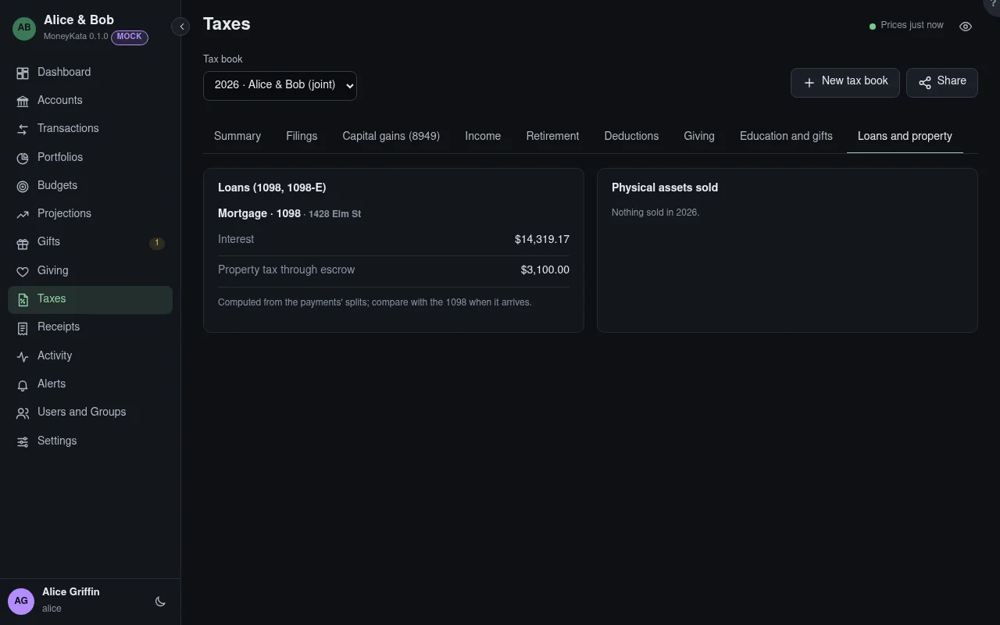

# Taxes: Loans and property

Mortgage and student-loan interest, and physical assets sold.

## Tax book

The book shown, for one tax year. Its panels count the book's accounts only, and say which were left
out.

## Loans (1098, 1098-E)

Interest, PMI and property tax through escrow per loan, from the payments' splits; compare with the
1098 when it arrives.

## Physical assets sold

Each item sold in the year with its gain; collectables are marked, and a loss on personal-use
property isn't deductible. A sold primary residence shows its gain and the years owned; the
exclusion is the preparer's to apply.
