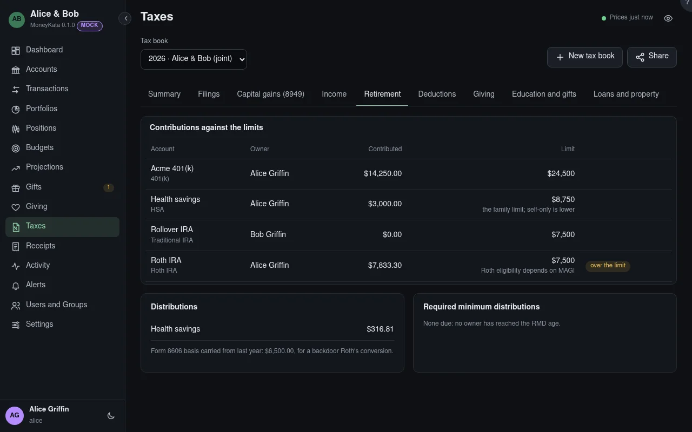

# Taxes: Retirement

Contributions against the year's limits, distributions, and the required minimum distributions due.

## Tax book

The book shown, for one tax year. Its panels count the book's accounts only, and say which were left out.

## Contributions against the limits

What went into each retirement account for the year, against its limit from the tax tables, with the catch-up by age. Roth eligibility depends on MAGI, which is the preparer's to check.

## Distributions

What came out of each retirement account. Form 8606's basis, carried from last year, is shown for a backdoor Roth's conversion.

## Required minimum distributions {#rmds}

For an owner at the RMD age: the account's value at the end of last year divided by the Uniform Lifetime Table's factor for their age.
