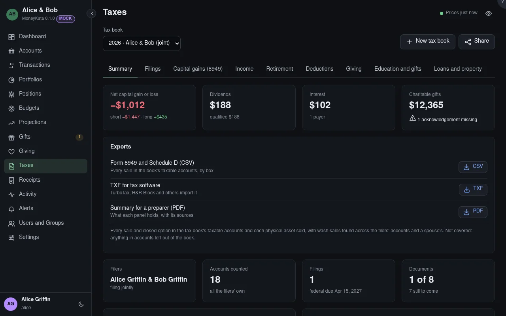

# Taxes: Summary

What a tax book holds: its filers, the accounts it counts, its filings and documents, and the
figures carried from last year.

## Tax book

The book shown: one tax year, for you alone or for you and your spouse filing jointly. **New tax
book** starts the next one; **Share** lets someone help, such as a preparer with an account here or
a grown child.

## Exports

Form 8949 and Schedule D as CSV, a TXF file that TurboTax, H&R Block and others import, and a PDF
summary for a preparer. Each says what it covers and what it doesn't.

## Accounts counted

The filers' own accounts, each once even when they share them with each other. **Leave out** one
that doesn't belong; the panels say what was left out.

## Add an account

An account you can see but don't own that belongs in this return, such as a custodial account in a
child's name.

## From last year

What last year's filings carried forward: the AGI needed to sign this year's e-filed return,
capital-loss and charitable carryovers, and the Form 8606 basis.

MoneyKata gathers what a preparer or tax software needs. It never computes the tax, chooses a filing
status, or files.
