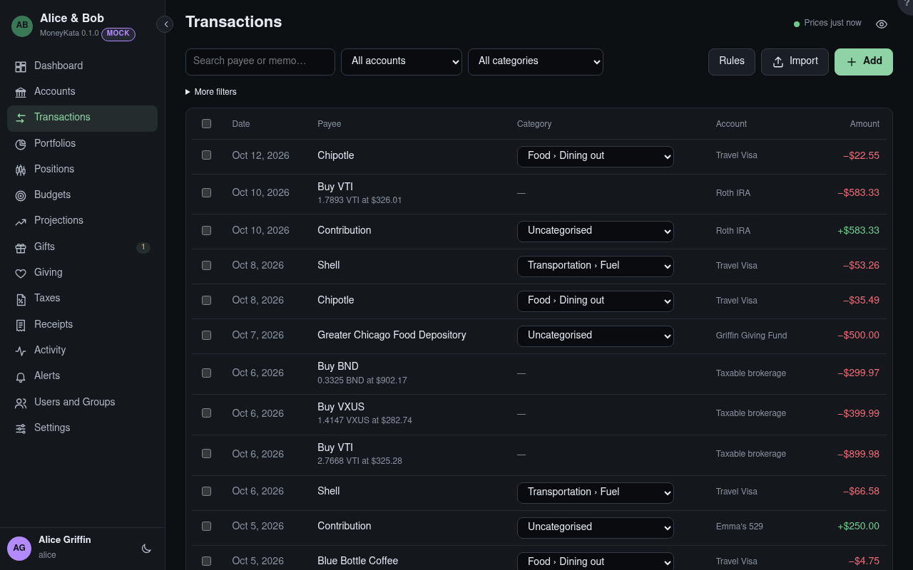

# Transactions

Every account's transactions together, newest first.

## Search {#search}

Finds a payee or memo containing what you type.

## Account

Shows one account's transactions.

## Category

Shows one category's transactions, or the **uncategorised** ones to sort.

## Rules

Your categorisation rules: what a payee looks like, and the category, payee and tags to set.
They run on what you import, and on the uncategorised when you choose. A transaction's own dialog
offers **Make a rule** from it.

## Import

OFX, QFX or CSV into one of your accounts.

## Add

Types a transaction by hand.

## From

The earliest date to show.

## To

The latest date to show.

## At least {#min}

Amounts at least this size, in or out: `25` finds −$30.00 and +$40.00.

## At most {#max}

Amounts at most this size.

## Tag

Your own tags; others who share the account don't see them.

## Categorise as

Select rows with their boxes, choose a category, and **Categorise** them together.

## +N new

Transactions that arrived while you were reading. A click shows them.
