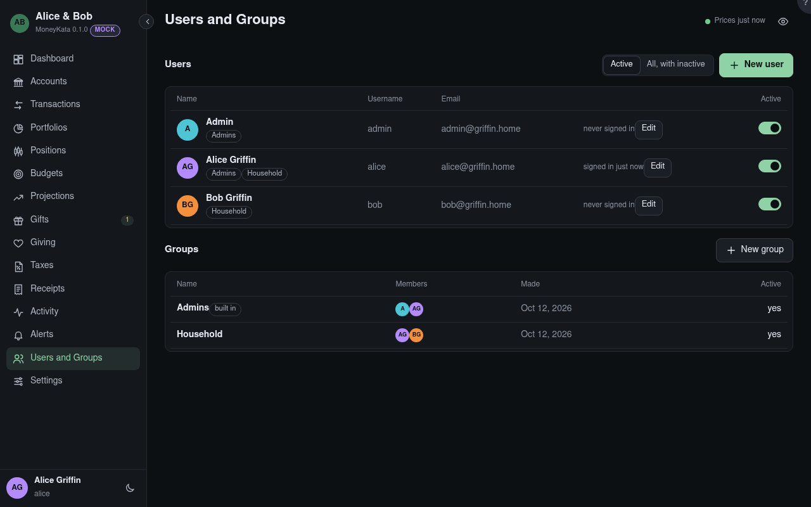

# Users and Groups

For admins: who uses this server and the groups shares are given to.

## Requests

People who asked for an account from the sign-in screen and confirmed their email. **Approve** makes
the user, in the group chosen beside it if any; **Reject** turns the request down. They get an email
either way.

## Group {#request-group}

The group an approved request joins. More can be added later with **Edit**.

## Asked to be made active again

People whose account is inactive and who asked, from the sign-in screen, to be made active.

## Show

**Active** users, or **all** of them with the inactive ones.

## New user

A name, username and email: they get an invitation and choose their own password. Admins never set
passwords.

## Resend invitation

A new invitation link, for someone who hasn't joined yet.

## Edit

A user's name and groups, and their email before they join. **two-step** beside a user means they
sign in with a code from an app; **Reset two-step** in Edit turns it off when they've lost the app
and their recovery codes.

## Active {#active}

Off ends the user's sessions at once and stops them signing in; shares they hold give them nothing
while they're inactive. Users are made inactive, never deleted. The last active admin can't be.

## New group

A named set of users that accounts and portfolios can be shared with. **Admins** is built in: its
members manage users, groups and Settings, and see others' money only when it's shared with them.
